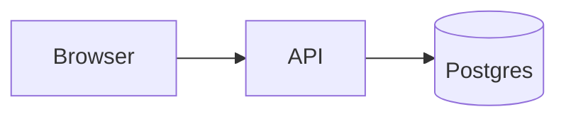

**Mermaid diagrams now render with [pele](https://pele.run) instead of the `mermaid` package.** Pages load far less JavaScript: each diagram type is a small chunk loaded only where it is used, instead of a multi-megabyte renderer.

Diagrams now follow the site theme. Node, edge and text colors come from `--foreground`, `--background`, `--primary` and the semantic colors, so they match your docs and switch with dark mode without re-rendering. On narrow screens diagrams re-layout to fit the column.

Nodes and subgraphs get category colors with no `classDef`:

Available colors are `blue`, `green`, `purple`, `pink`, `red`, `amber`, `orange` and `teal`. The Mintlify `actions` and `placement` fence options now control the zoom controls.
