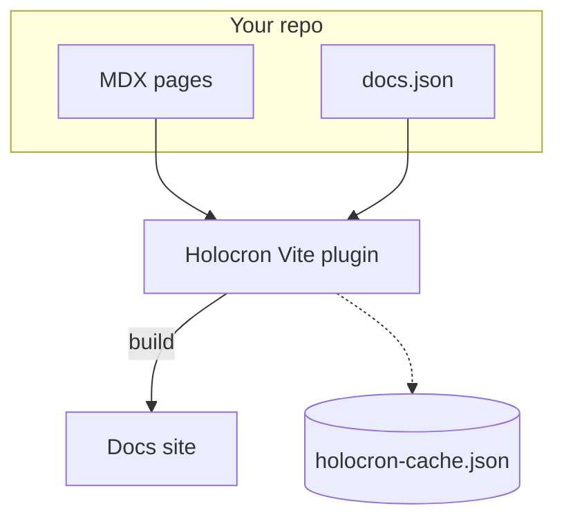
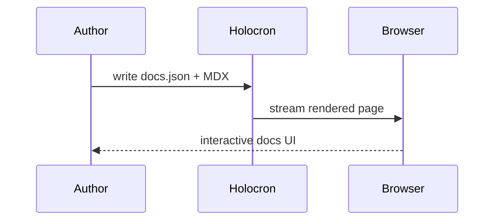
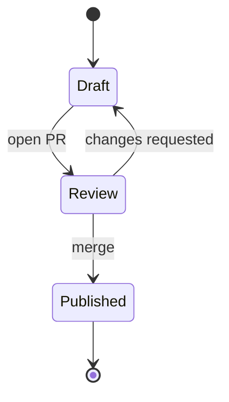
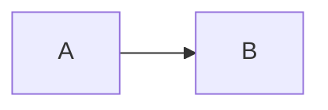

# Mermaid Diagrams

Write a fenced **`mermaid`** block and Holocron renders it as an SVG diagram. Colors come from your site theme, so diagrams switch with **dark mode** and follow any CSS variables you override.



````mdx

````

## Color classes

Add **`:::blue`**, `:::green`, `:::purple`, `:::pink`, `:::red`, `:::amber`, `:::orange` or `:::teal` to a node to give it a category color. Use `class <subgraph> green` for subgraphs. No `classDef` is needed, and the colors adapt to dark mode.

<Aside>
<Tip>
A **`classDef`** with the same name wins over the built-in color, so existing diagrams keep their own styles.
</Tip>
</Aside>

Pick one color per kind of thing: for example clients green, your services blue, third parties purple and storage amber.

## Diagram types

Flowcharts, **sequence diagrams**, state diagrams, class and ER diagrams, Gantt charts, pie charts, git graphs, mindmaps and more are supported. Each type loads only on the pages that use it.





## Zoom controls

Diagrams wider than the content column shrink to fit and show **zoom controls**. Set **`actions`** to always show or always hide them, and **`placement`** to move them: `top-left`, `top-right`, `bottom-left` or `bottom-right` (the default).

````mdx

````

## Theming

Diagrams read Holocron theme variables like **`--foreground`**, `--background`, `--primary` and the semantic colors `--blue`, `--green`, and so on. Override them in your CSS and diagrams follow. To change only diagrams, set [pele variables](https://pele.run/theming) on `.mermaid-diagram`:

```css
.mermaid-diagram {
  --pele-line: var(--primary);
  --pele-radius: 4px;
}
```
